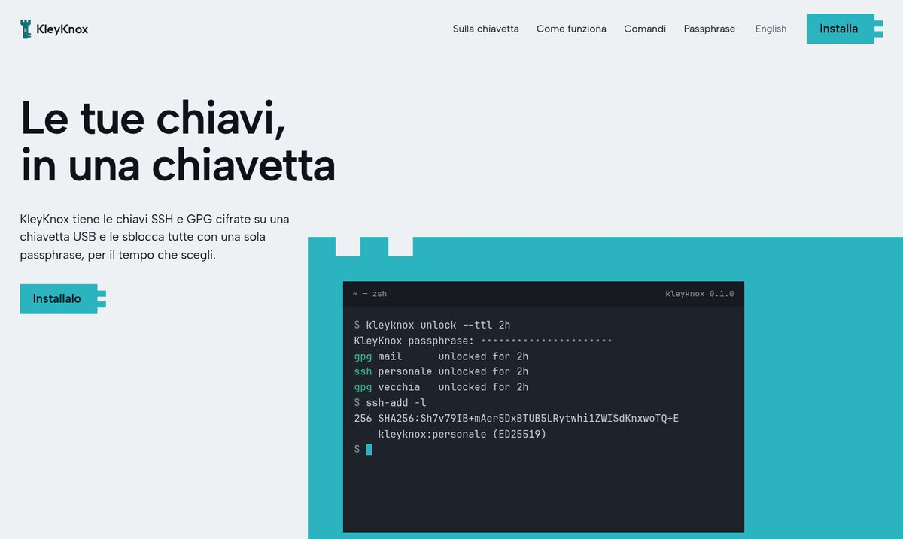
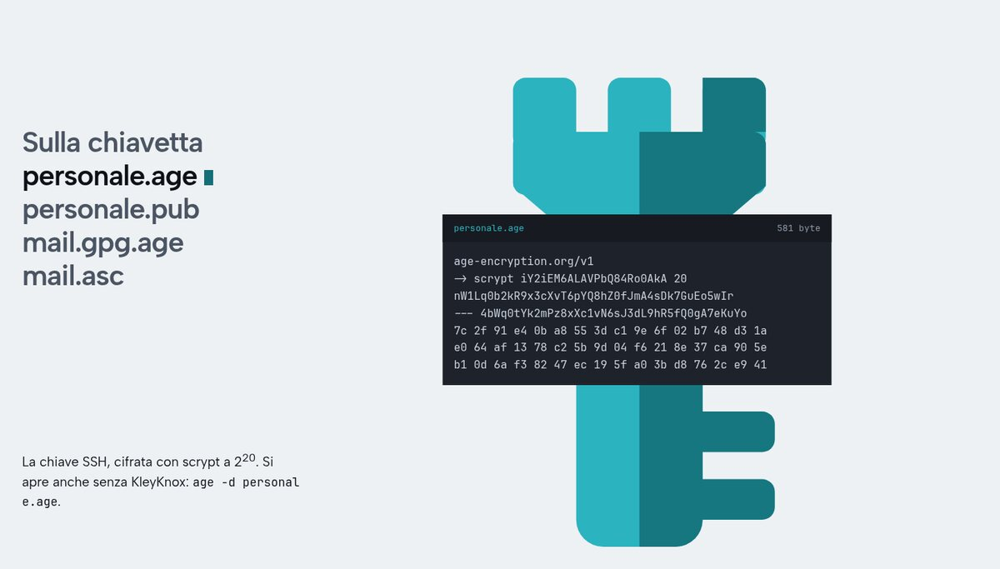
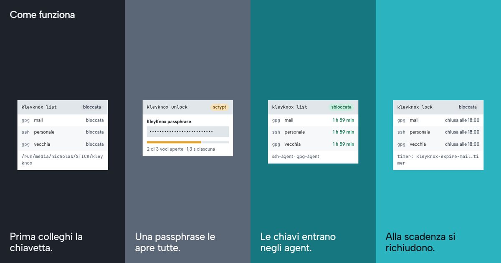
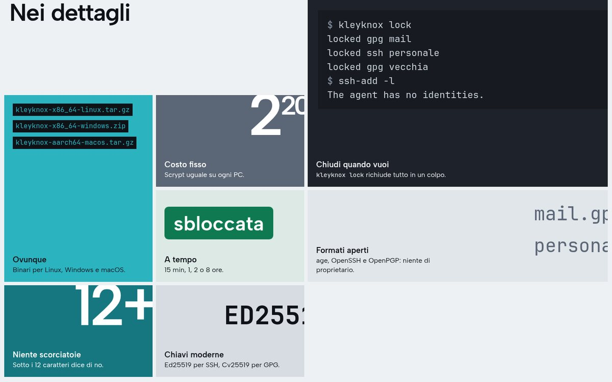
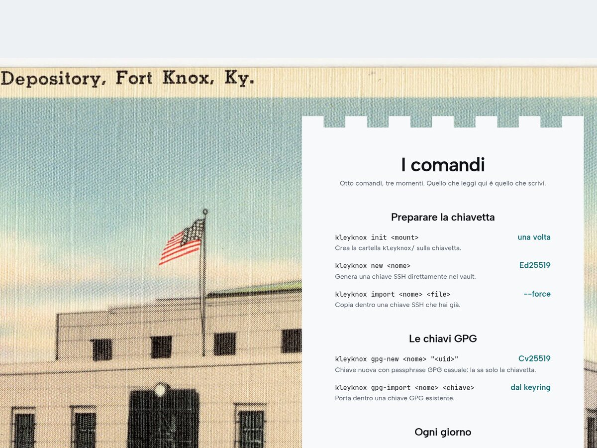
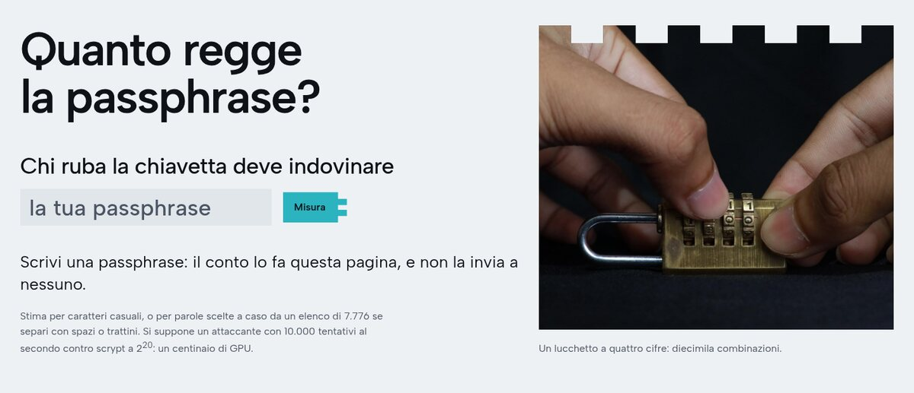
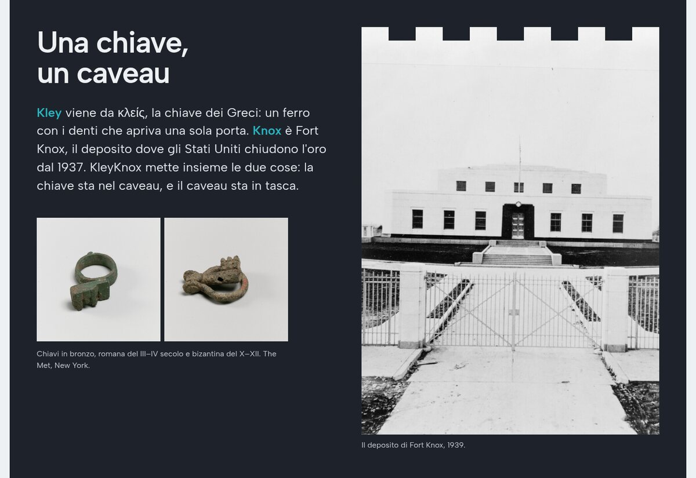

<p align="center">
  
</p>

<p align="center"><a href="README.md">English</a> · <strong>Italiano</strong></p>

<h1 align="center">KleyKnox</h1>

<p align="center">
  <strong>Le tue chiavi, in una chiavetta.</strong><br>
  Chiavi SSH e GPG cifrate su una chiavetta USB, sbloccate tutte con una sola passphrase, per il tempo che scegli.
</p>

<p align="center">
  <a href="https://github.com/Nidhil-stack/kleyknox/actions/workflows/ci.yml"></a>
  
  
  <a href="https://nidhil-stack.github.io/kleyknox/"></a>
</p>



```console
$ kleyknox unlock --ttl 2h
KleyKnox passphrase: ••••••••••••••••••••••
gpg mail      unlocked for 2h
ssh personale unlocked for 2h
gpg vecchia   unlocked for 2h
```

## Sulla chiavetta



Una cartella `kleyknox/`, e niente lì dentro si legge senza la passphrase:

| File | Contiene |
| --- | --- |
| `<nome>.age` + `<nome>.pub` | Una chiave privata OpenSSH Ed25519, cifrata; la chiave pubblica in chiaro |
| `<nome>.gpg.age` + `<nome>.asc` | Una chiave segreta GPG **e** la passphrase casuale che la protegge, cifrate insieme; la chiave pubblica |

Ogni file `.age` è [age](https://age-encryption.org) standard con destinatario scrypt a costo fisso 2<sup>20</sup> (circa 1,3 s per tentativo su un portatile): si apre su qualsiasi PC, anche senza KleyKnox, con `age -d personale.age`.

## Come funziona



1. **Colleghi la chiavetta.** KleyKnox trova `kleyknox/` su qualsiasi volume montato (`/run/media`, `/media`, `/Volumes`, lettere di unità `D:`–`Z:`), oppure dove indicano `--dir` o `KLEYKNOX_DIR`.
2. **Scrivi una sola passphrase.** Apre tutte le voci.
3. **Le chiavi vanno negli agent, non sul disco.** Le chiavi SSH vengono decifrate in memoria e passate a `ssh-agent` tramite il suo socket (una named pipe su Windows), con una scadenza. Le chiavi GPG vengono importate ancora protette, e la loro passphrase viene preimpostata in `gpg-agent`.
4. **Alla scadenza si richiudono.** Un timer utente di systemd, o un piccolo processo staccato dove systemd manca, esegue `kleyknox lock`.

## Nei dettagli



- **Chiudi quando vuoi:** `kleyknox lock` richiude tutte le chiavi in un colpo, prima della scadenza.
- **Ovunque:** binari per Linux, Windows e macOS, la stessa chiavetta su tutti e tre.
- **A tempo:** `--ttl 15m`, `1h`, `2h` (predefinito), `8h`, oppure `none`.
- **Niente scorciatoie:** le passphrase sotto i 12 caratteri vengono rifiutate. Chi ha la chiavetta può provare offline, all'infinito.
- **Chiavi moderne:** Ed25519 per SSH, Ed25519 + Cv25519 per GPG.

## I comandi



| | Comando | |
| --- | --- | --- |
| **Preparare** | `kleyknox init <mount>` | Crea `kleyknox/` sulla chiavetta, una volta sola |
| | `kleyknox new <nome>` | Genera una chiave SSH Ed25519 direttamente nel vault |
| | `kleyknox import <nome> <file>` | Copia dentro una chiave SSH che hai già |
| **GPG** | `kleyknox gpg-new <nome> "<uid>"` | Chiave nuova, con una passphrase GPG casuale che conosce solo la chiavetta |
| | `kleyknox gpg-import <nome> <chiave>` | Porta dentro una chiave GPG dal tuo keyring |
| **Ogni giorno** | `kleyknox unlock [nome] --ttl 2h` | Una passphrase, tutte le chiavi, per il tempo scelto |
| | `kleyknox lock [nome]` | Richiude prima della scadenza |
| | `kleyknox list` | Cosa c'è sulla chiavetta, e cosa è aperto |

`kleyknox --help` si apre con la chiave stessa, disegnata con i caratteri di un armor:

```text
  KY//KW    VEG590    e6tqxs
 FK18HTDF  LJXKKPFX  jnxna9kq
 M7FRIF3Y  02XMICKY  f7arz1u9
 UQGHKFWW1PISGAzhrsdyvyhyos6z
 YGODUBG5PHIW0Tdwpp6r7d4jqonf
 H+UAEBW2ZYM8RO6lastaqx8baygt
 JR2UFQQYUDK4M4kmpaoh80wzaztt
   F2KPHOGCN8FAk7dlnuctkqtj
      4CY7MLGKW+r60ec3j8
        HLOQEXXdzaojsy
        Z1PGB6F9czpble
        FIK/GAMpf4k4kv
        X0HJH W+ lwi9/
        UC5E  Sk  6a2z
        XVPF  Bw  tfip
        BCHQ  Wn  sfix
        UPPQ  P5  wvmx
        A52HH/5rellto/
        BFHQRN6/jich60
        O02IQFQlq4suljt9zn7e/e
        GT8QAVAgho7pulttqu9xud
        GS75AIN+zvugv5
        43VDWTPcnhxn2o
        DTDAZGFdtcsgkyue+3r1jm
        K4BMMNT3vi904vh+8o+d09
        AE7AX4Kzfoa0bj
           SFCFk4==
```

## Installare

```sh
git clone https://github.com/Nidhil-stack/kleyknox
cd kleyknox && cargo install --path .
```

Oppure prendi un binario per Linux, Windows o macOS dalle [release](https://github.com/Nidhil-stack/kleyknox/releases).

| Serve | Per |
| --- | --- |
| OpenSSH 8.2+ con un `ssh-agent` attivo | Le chiavi SSH. Linux: `systemctl --user enable --now ssh-agent.socket`. Windows: avvia il servizio *OpenSSH Authentication Agent* |
| GnuPG 2.4 (`gpg` e `gpgconf` nel `PATH`; gpg4win su Windows) | Le chiavi GPG. Il primo sblocco aggiunge `allow-preset-passphrase` a `gpg-agent.conf` |
| systemd (facoltativo) | Timer di scadenza precisi; senza, la chiusura la fa un processo `kleyknox` staccato |

## Quanto regge la passphrase?



La chiavetta è forte quanto la sua passphrase, perché un ladro può provare passphrase offline. Ogni tentativo costa un giro di scrypt a 2<sup>20</sup> (1 GiB di memoria). Il [sito](https://nidhil-stack.github.io/kleyknox/#passphrase) stima quanto reggerebbe la tua contro 10.000 tentativi al secondo, nel browser, senza inviarla da nessuna parte. Cinque o sei parole casuali sono una buona risposta.

## Limiti, onestamente

- Mentre le chiavi sono aperte, qualsiasi processo che gira col tuo utente può usarle tramite gli agent. Tieni `--ttl` breve; per SSH, `--confirm` chiede conferma a ogni uso (dove l'agent lo supporta).
- Le chiavi GPG restano nel keyring di ogni PC dove le sblocchi, protette da una passphrase che conosce solo la chiavetta. Sui PC non tuoi toglile con `gpg --delete-secret-keys`.
- Su Windows l'agent OpenSSH tiene le chiavi aggiunte nel registro (cifrate con DPAPI) finché non vengono tolte; KleyKnox le toglie alla scadenza o con `kleyknox lock`.
- Nessun audit indipendente. Per chiavi di grande valore, meglio un token hardware.

## Il nome



**Kley** è κλείς, la chiave dei Greci. **Knox** è Fort Knox, il caveau dove gli Stati Uniti tengono l'oro dal 1937. La chiave sta nel caveau, e il caveau sta in tasca.

---

<sub>Immagini: deposito di Fort Knox, 1939, Committee on Architectural Surveys, pubblico dominio; *Gold Vault, U. S. Depository, Fort Knox, Ky*, Tichnor Bros., pubblico dominio (Wikimedia Commons). Chiave ad anello romana e chiave pieghevole bizantina in bronzo, The Metropolitan Museum of Art, CC0. Video *Opening a padlock* di Wasiul Bahar, CC BY-SA 4.0, via Wikimedia Commons. Codice: GPL-3.0-or-later.</sub>
