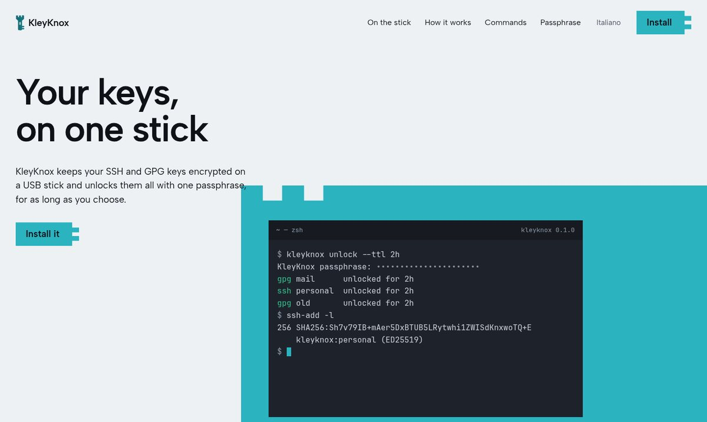
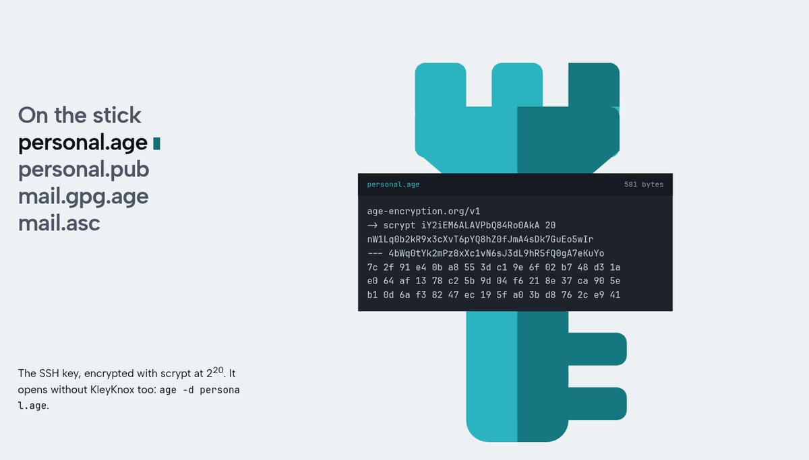
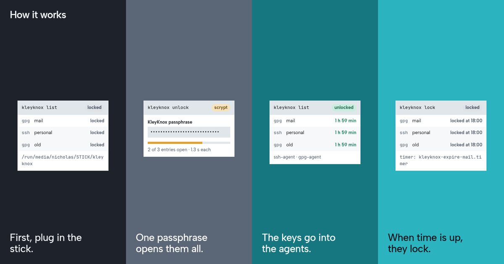
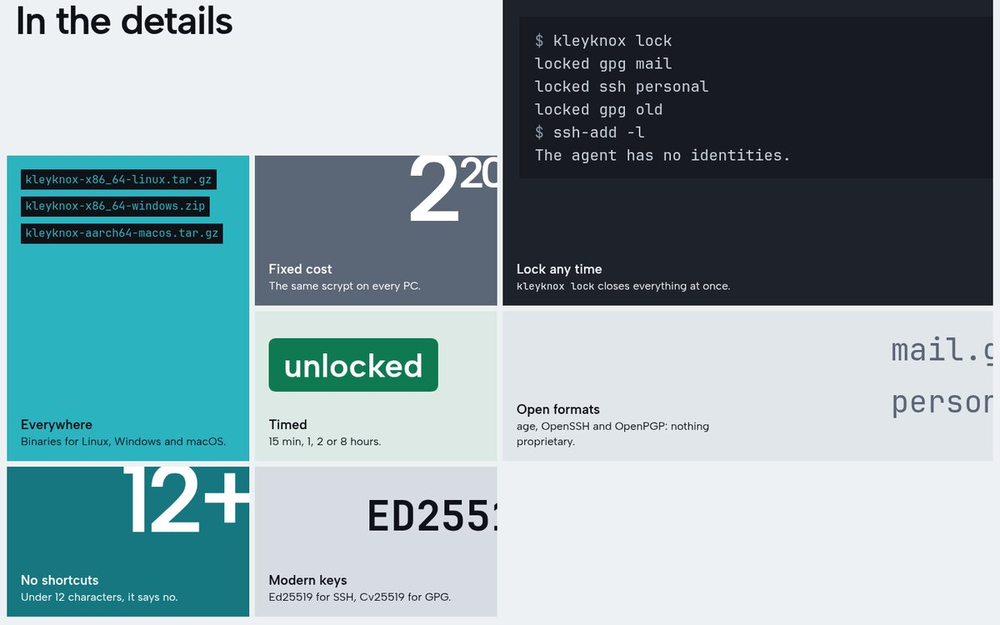
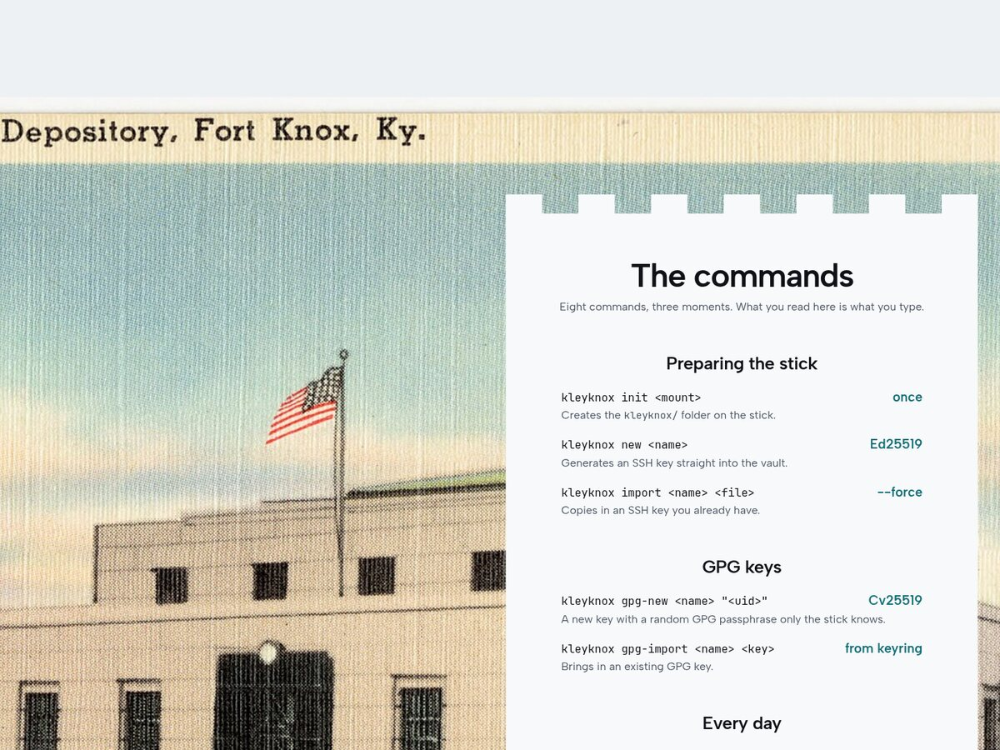
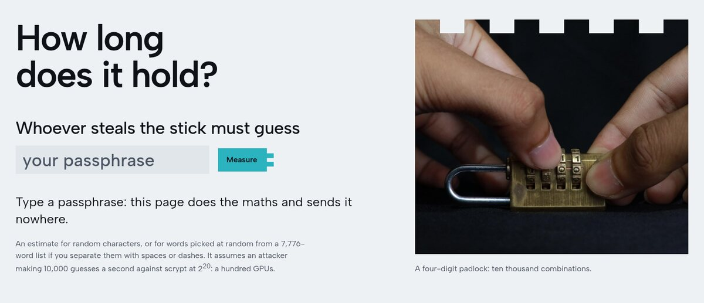
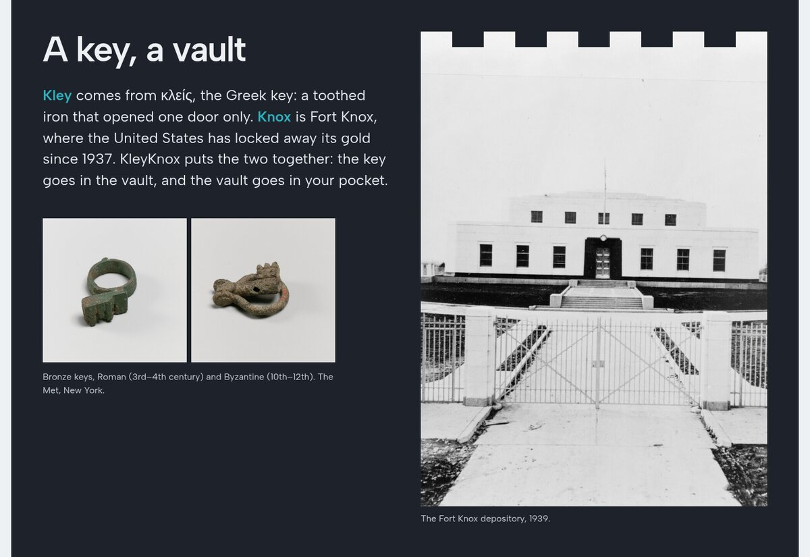

<p align="center">
  
</p>

<p align="center"><strong>English</strong> · <a href="README.it.md">Italiano</a></p>

<h1 align="center">KleyKnox</h1>

<p align="center">
  <strong>Your keys, on one stick.</strong><br>
  SSH and GPG keys kept encrypted on a USB stick, all unlocked with one passphrase, for as long as you choose.
</p>

<p align="center">
  <a href="https://github.com/Nidhil-stack/kleyknox/actions/workflows/ci.yml"></a>
  
  
  <a href="https://nidhil-stack.github.io/kleyknox/en/"></a>
</p>



```console
$ kleyknox unlock --ttl 2h
KleyKnox passphrase: ••••••••••••••••••••••
gpg mail      unlocked for 2h
ssh personal  unlocked for 2h
gpg old       unlocked for 2h
```

## What is on the stick



A `kleyknox/` folder, and nothing in it is readable without the passphrase:

| File | Holds |
| --- | --- |
| `<name>.age` + `<name>.pub` | An OpenSSH Ed25519 private key, encrypted; its public key in the clear |
| `<name>.gpg.age` + `<name>.asc` | A GPG secret key **and** the random passphrase that protects it, encrypted together; the public key |

Every `.age` file is plain [age](https://age-encryption.org) with an scrypt recipient at a fixed cost of 2<sup>20</sup> (about 1.3 s per guess on a laptop), so it opens on any PC, and without KleyKnox: `age -d personal.age`.

## How it works



1. **Plug in the stick.** KleyKnox finds `kleyknox/` on any mounted volume (`/run/media`, `/media`, `/Volumes`, drive letters `D:`–`Z:`), or wherever `--dir` / `KLEYKNOX_DIR` points.
2. **Type one passphrase.** It opens every entry.
3. **Keys go into the agents, not onto the disk.** SSH keys are decrypted in memory and handed to `ssh-agent` over its socket (a named pipe on Windows), with a lifetime. GPG keys are imported only for the session, still protected, and their passphrase is preset in `gpg-agent`.
4. **When the time is up they lock again.** A systemd user timer, or a small detached process where systemd is missing, runs `kleyknox lock`: SSH keys leave the agent, GPG passphrases are forgotten, and every GPG secret key KleyKnox imported is deleted from the keyring again (the public key stays). Keys that were already in your keyring are never touched.

## In the details



- **Lock any time:** `kleyknox lock` closes every key at once, before the time is up.
- **Everywhere:** binaries for Linux, Windows and macOS, the same stick on all three.
- **Timed:** `--ttl 15m`, `1h`, `2h` (default), `8h`, or `none`.
- **No shortcuts:** passphrases under 12 characters are refused. Anyone holding the stick can guess offline, forever.
- **Modern keys:** Ed25519 for SSH, Ed25519 + Cv25519 for GPG.

## The commands



| | Command | |
| --- | --- | --- |
| **Prepare** | `kleyknox init <mount>` | Create `kleyknox/` on the stick, once |
| | `kleyknox new <name>` | Generate an Ed25519 SSH key straight into the vault |
| | `kleyknox import <name> <file>` | Copy in an SSH key you already have |
| **GPG** | `kleyknox gpg-new <name> "<uid>"` | New key, with a random GPG passphrase only the stick knows |
| | `kleyknox gpg-import <name> <key>` | Bring in a GPG key from your keyring |
| **Every day** | `kleyknox unlock [name] --ttl 2h` | One passphrase, every key, for the time chosen |
| | `kleyknox lock [name]` | Lock before the time is up |
| | `kleyknox list` | What is on the stick, and what is open |

`kleyknox --help` opens with the key itself, drawn in armor characters:

```text
  KY//KW    VEG590    e6tqxs
 FK18HTDF  LJXKKPFX  jnxna9kq
 M7FRIF3Y  02XMICKY  f7arz1u9
 UQGHKFWW1PISGAzhrsdyvyhyos6z
 YGODUBG5PHIW0Tdwpp6r7d4jqonf
 H+UAEBW2ZYM8RO6lastaqx8baygt
 JR2UFQQYUDK4M4kmpaoh80wzaztt
   F2KPHOGCN8FAk7dlnuctkqtj
      4CY7MLGKW+r60ec3j8
        HLOQEXXdzaojsy
        Z1PGB6F9czpble
        FIK/GAMpf4k4kv
        X0HJH W+ lwi9/
        UC5E  Sk  6a2z
        XVPF  Bw  tfip
        BCHQ  Wn  sfix
        UPPQ  P5  wvmx
        A52HH/5rellto/
        BFHQRN6/jich60
        O02IQFQlq4suljt9zn7e/e
        GT8QAVAgho7pulttqu9xud
        GS75AIN+zvugv5
        43VDWTPcnhxn2o
        DTDAZGFdtcsgkyue+3r1jm
        K4BMMNT3vi904vh+8o+d09
        AE7AX4Kzfoa0bj
           SFCFk4==
```

## Install

```sh
git clone https://github.com/Nidhil-stack/kleyknox
cd kleyknox && cargo install --path .
```

Or take a binary for Linux, Windows or macOS from the [releases](https://github.com/Nidhil-stack/kleyknox/releases).

| Needs | For |
| --- | --- |
| OpenSSH 8.2+ with a running `ssh-agent` | SSH keys. Linux: `systemctl --user enable --now ssh-agent.socket`. Windows: start the *OpenSSH Authentication Agent* service |
| GnuPG 2.4 (`gpg`, `gpgconf` on `PATH`; gpg4win on Windows) | GPG keys. The first unlock adds `allow-preset-passphrase` to `gpg-agent.conf` |
| systemd (optional) | Exact expiry timers; without it a detached `kleyknox` process does the locking |

## How much does the passphrase hold?



The stick is only as strong as its passphrase, because a thief can try passphrases offline. Each guess costs one scrypt run at 2<sup>20</sup> (1 GiB of memory). The [site](https://nidhil-stack.github.io/kleyknox/en/#passphrase) estimates how long yours would hold against 10,000 guesses a second, in your browser, without sending it anywhere. Five or six random words is a good answer.

## Limits, honestly

- While keys are unlocked, any process running as you can use them through the agents. Keep `--ttl` short; for SSH, `--confirm` asks on every use (where the agent supports it).
- While a GPG key is unlocked, its secret part sits in the GnuPG keyring on disk, protected by a passphrase only the stick knows. If the PC dies before `lock`, the next `kleyknox unlock` or `lock` removes it.
- On Windows, the OpenSSH agent keeps added keys in the registry (DPAPI-encrypted) until they are removed; KleyKnox removes them at expiry or on `kleyknox lock`.
- Not audited. For high-stakes keys, prefer a hardware token.

## The name



**Kley** is κλείς, the Greek key. **Knox** is Fort Knox, the vault where the United States has kept its gold since 1937. The key goes in the vault, and the vault goes in your pocket.

---

<sub>Pictures: United States Bullion Depository, 1939, Committee on Architectural Surveys, public domain; *Gold Vault, U. S. Depository, Fort Knox, Ky*, Tichnor Bros., public domain (Wikimedia Commons). Roman bronze ring key and Byzantine bronze folding key, The Metropolitan Museum of Art, CC0. Video *Opening a padlock* by Wasiul Bahar, CC BY-SA 4.0, via Wikimedia Commons. Code: GPL-3.0-or-later.</sub>
